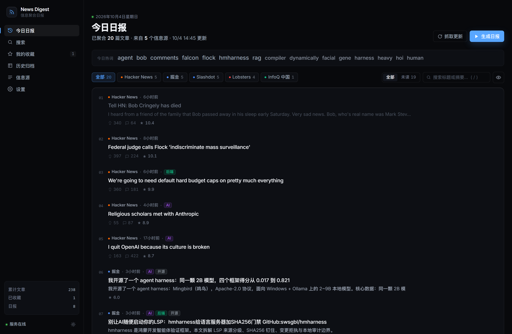
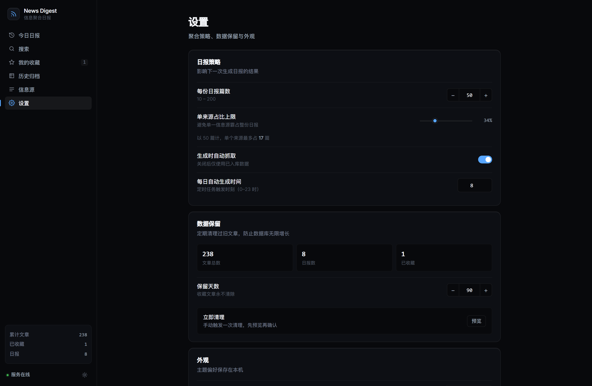

<div align="center">

# News Digest

**自动聚合全球科技资讯，生成每日精选日报**

一个自托管的信息聚合机器人：定时抓取 14 个技术社区，把上千条内容去重、评分、
按来源配额平衡，生成一份可读性强的每日日报。

[](LICENSE)
[](https://nodejs.org)
[](https://vuejs.org)

</div>

---

## 特性

**内容聚合**

- **14 个信息源** —— Hacker News、GitHub Trending、V2EX、掘金、Product Hunt、36氪、虎嗅、Reddit、Lobsters、InfoQ、Solidot、少数派、机器之心、Slashdot
- **三层去重** —— URL 规范化（去协议/www/查询串）+ 标题归一化比对 + 近似标题合并
- **智能评分** —— 热度（对数缩放，避免大票碾压）、评论数、来源权重、时效性、关键词加成
- **来源多样性** —— 配额轮询选稿，单一来源默认不超过 34%，避免日报退化成单一社区搬运
- **失败可观测** —— 每个源的抓取结果入库并在界面显示，失效源不会伪装成成功

**阅读体验**

- 今日热词云（字号随词频，点击即搜索）
- 跨日报全局搜索，支持时间范围过滤
- 未读 / 已读状态追踪，键盘即可批量标记
- 收藏夹、来源筛选、标签过滤
- 键盘快捷键：`j`/`k` 上下浏览 · `/` 搜索 · `s` 收藏 · `o` 打开 · `?` 帮助
- 明暗双主题，偏好持久化

**输出**

- Markdown 导出
- RSS 订阅（每份日报一个 feed）
- 单进程部署：后端自动托管前端构建产物

---

## 截图

<details>
<summary><b>今日日报（深色）</b></summary>



</details>

<details>
<summary><b>设置页</b></summary>



</details>

---

## 快速开始

**环境要求**：Node.js ≥ 18

```bash
# 1. 安装依赖
cd backend && npm install
cd ../frontend && npm install

# 2. 启动后端（:3210）
cd backend && npm start

# 3. 另开一个终端，启动前端（:5180）
cd frontend && npm run dev
```

打开 <http://localhost:5180>

### 单进程模式

先构建前端，之后只启动后端即可（默认托管在 :3210）：

```bash
cd frontend && npm run build
cd ../backend && npm start
# 打开 http://localhost:3210
```

### 检查信息源可用性

```bash
cd backend
npm run test:scrapers                    # 全部
npm run test:scrapers hackernews juejin  # 指定
```

输出示例：

```
  OK    hackernews       1410ms   30 articles
  OK    juejin            223ms   20 articles
  FAIL  reddit          21039ms   Reddit: The operation was aborted.

  2/3 sources healthy · 50 articles · 22.4s
```

---

## 使用

### 定时任务

后端启动后会在每天 **08:00**（可在设置页调整，保存后立即生效）自动抓取并生成日报。
另有 **03:20** 的清理任务，删除超过保留期（默认 90 天）且未被收藏的文章。

### 设置项

| 设置 | 说明 | 默认 |
|---|---|---|
| 每份日报篇数 | 10–200 | 50 |
| 单来源占比上限 | 0.1–1.0，防止单一源霸占 | 0.34 |
| 生成时自动抓取 | 关闭后仅使用已入库数据 | 开 |
| 每日生成时刻 | 0–23 时，保存后立即重排任务 | 8 |
| 保留天数 | 收藏文章永不清除 | 90 |

### 快捷键

在日报列表中可用（输入框内自动禁用）：

| 按键 | 作用 |
|---|---|
| `j` / `↓` | 下一条 |
| `k` / `↑` | 上一条 |
| `/` | 聚焦搜索框 |
| `o` / `Enter` | 打开选中项 |
| `s` | 收藏 / 取消收藏 |
| `Esc` | 清空搜索 |
| `?` | 显示快捷键面板 |

---

## 项目结构

```
news-digest-bot/
├── backend/
│   ├── src/
│   │   ├── index.js              # 服务入口、定时任务、抓取流水线
│   │   ├── db.js                 # sql.js 封装、建表、迁移、原子落盘
│   │   ├── scoring.js            # 评分、去重、摘要清洗、热词提取、来源配额
│   │   ├── scrapers/index.js     # 14 个信息源抓取器
│   │   ├── test-scrapers.js      # 信息源健康检查
│   │   └── routes/               # articles / digests / sources / settings
│   └── package.json
├── frontend/
│   └── src/
│       ├── App.vue               # 侧边栏、主题、全局状态
│       ├── api.js                # 统一 API 客户端
│       ├── assets/app.css        # 设计系统（token / 基础组件）
│       ├── composables/          # 快捷键、Toast
│       ├── utils/format.js       # 时间、数字、来源元数据
│       ├── components/           # ArticleCard、ToastHost
│       └── views/                # 6 个页面
└── docs/research.md              # 同类项目调研
```

---

## API

| 方法 | 路径 | 说明 |
|---|---|---|
| `GET` | `/api/health` | 健康检查 |
| `GET` | `/api/meta` | 概览统计 |
| `GET` | `/api/stats` | 文章数、来源分布、30 天趋势 |
| `GET` | `/api/digests` | 日报列表 |
| `GET` | `/api/digests/latest` | 最新日报（含文章） |
| `GET` | `/api/digests/:id` | 指定日报 |
| `GET` | `/api/digests/:id/markdown` | 导出 Markdown |
| `GET` | `/api/digests/:id/rss` | RSS 订阅 |
| `POST` | `/api/digests/generate` | 生成日报（`{ skipFetch, force }`） |
| `POST` | `/api/fetch` | 仅抓取（`{ sources: [...] }`） |
| `GET` | `/api/articles` | 文章列表（`source` `q` `tag` `range` `order` `limit` `offset`） |
| `GET` | `/api/articles/search` | 跨日报搜索 |
| `GET` | `/api/articles/tags` | 标签统计 |
| `GET` | `/api/articles/bookmarks/all` | 收藏列表 |
| `POST` | `/api/articles/:id/star` | 收藏 / 取消 |
| `POST` | `/api/articles/:id/read` | 标记已读 / 未读 |
| `POST` | `/api/articles/bulk` | 批量操作（`ids` / `digest_id` / `source`） |
| `GET` | `/api/sources` | 信息源列表（含健康状态） |
| `GET` | `/api/sources/health` | 抓取健康汇总 |
| `PUT` | `/api/sources/:key` | 启用状态 / 权重 / 颜色 |
| `GET` `PUT` | `/api/settings` | 读写设置（带范围校验） |
| `POST` | `/api/prune` | 清理旧数据（`{ confirm: true }` 才真正删除） |

---

## 实现说明

几个不太显然但重要的设计：

**日报用多对多关联，而不是在文章上存单个 `digest_id`。**
早期版本每次生成日报就更新文章的 `digest_id`，导致旧日报里的文章被整体搬走
（实测有一份日报声称 39 篇、实际只剩 18 篇）。现在用 `digest_articles` 关联表，
同一篇文章可以属于多份日报。

**抓取有三重超时保护。**
`node-fetch` v3 移除了 `timeout` 选项，只认 `AbortSignal`——写 `timeout: 15000`
是**完全无效**的，任何不响应的源都会挂住整轮抓取。现在是：请求层
`AbortSignal.timeout`、单源 25s 上限、总流程 180s 上限。

**抓取失败必须抛错。**
所有爬虫早期都写成 `catch { return [] }`，导致源挂掉时健康状态仍显示「正常」，
只是 0 篇。现在统一包装成 `attempt()`，失败进 `fetch_log` 表并在界面显示原因。

**摘要不做无意义的重复。**
标题即摘要、裸链接、`&frx2F;` 这类实体乱码都会被清洗掉——它们让列表看起来像坏了。

**数据库原子落盘。**
先写临时文件再 `rename`，避免进程被杀时留下损坏的数据库。

---

## 常见问题

**抓不到某些源？**
用 `npm run test:scrapers` 逐个排查。常见原因是目标站点限流、网络不通，
或站点改版导致选择器失效。GitHub Trending 和 Reddit 对数据中心 IP 比较敏感。

**端口被占用？**
后端 `PORT=3310 npm start`，前端改 `frontend/vite.config.js` 里的端口和代理目标。

**数据存在哪？**
`backend/data/digest.sqlite`（sql.js，纯文件无需安装数据库）。该目录已在
`.gitignore` 中，删掉即可重置。

**定时任务没跑？**
定时任务只在后端进程存活时生效，关掉终端就停了。长期运行建议用
`pm2`、`systemd` 或 Docker。

---

## License

[MIT](LICENSE)

内容版权归各原始来源所有，本项目仅作聚合与索引用途。
